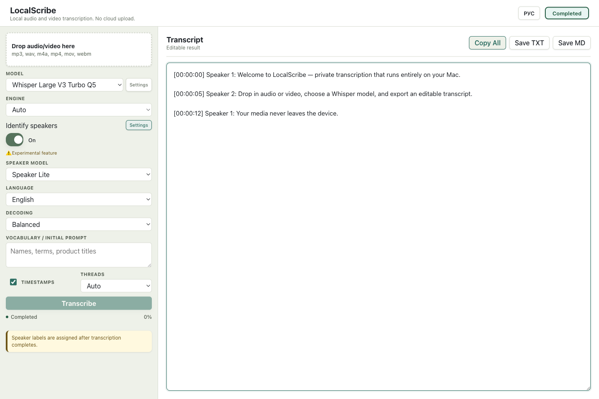
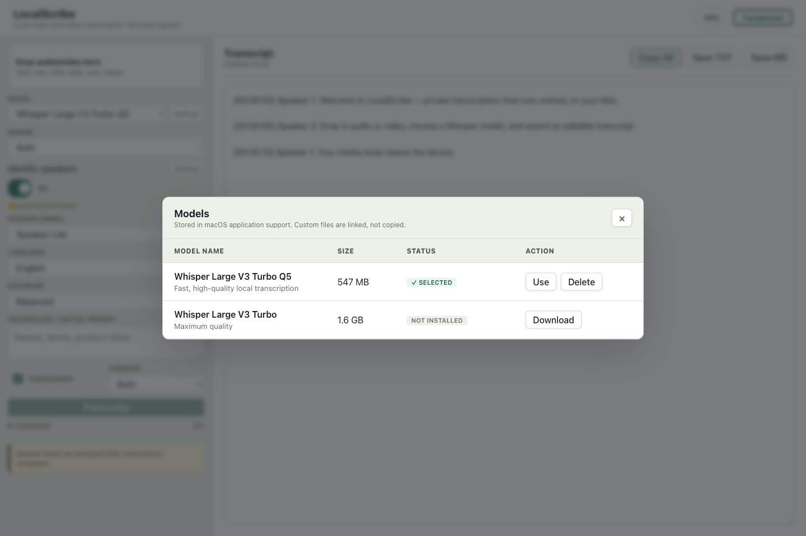

# LocalScribe

**Private, offline audio and video transcription for Apple Silicon Macs.**

[](https://github.com/ukolov-dev/LocalScribe/actions/workflows/ci.yml)
[](LICENSE)


LocalScribe is a privacy-first desktop speech-to-text app for macOS. It transcribes audio and video locally with Whisper/whisper.cpp, keeps media on your Mac, and produces editable transcripts with timestamps and optional speaker labels.



> [!NOTE]
> LocalScribe is currently a source-first alpha for Apple Silicon on macOS 13+. Signed and notarized binary releases are not available yet.

## Why LocalScribe?

- **Offline transcription:** audio and video are processed on-device instead of being uploaded to a cloud transcription service.
- **Local Whisper models:** download supported GGML models or select a custom Whisper `.bin` file.
- **macOS-native workflow:** drag and drop media, use the native file picker, and run Whisper with Metal or CPU.
- **Useful output:** edit the transcript, keep timestamps, add experimental speaker labels, and export to `TXT` or Markdown.
- **Multilingual speech recognition:** use automatic, multilingual, or language-specific decoding modes.
- **Open source:** built with Tauri 2, Rust, React, TypeScript, `whisper-rs`, whisper.cpp, and FFmpeg.

## How It Works

1. Install or select a local Whisper model.
2. Drop an audio or video file into LocalScribe.
3. Choose language, decoding quality, timestamps, and optional speaker detection.
4. Transcribe locally, edit the result, and export it.

## Whisper Model Manager

Models are stored in macOS Application Support. Custom files are linked from their existing location rather than copied.



Supported built-in models:

- `large-v3-turbo-q5_0` — recommended balance of speed, memory use, and quality.
- `large-v3-turbo` — higher quality with greater CPU and memory requirements.
- Custom Whisper-compatible GGML `.bin` models.

Default model directory:

```text
~/Library/Application Support/LocalScribe/models/
```

## Requirements

- Apple Silicon Mac (M1 or newer recommended).
- macOS 13 or newer.
- Node.js 18+.
- Rust stable toolchain.
- Xcode Command Line Tools.

## Build and Run

Install the frontend dependencies:

```bash
npm ci
```

Start the Tauri desktop app in development mode:

```bash
npm run tauri dev
```

Create a local macOS app build:

```bash
npm run tauri build
```

## Development and Tests

Build the React frontend:

```bash
npm run build
```

Run the Rust test suite:

```bash
cargo test --manifest-path src-tauri/Cargo.toml
```

Run a fast Rust compile check:

```bash
cargo check --manifest-path src-tauri/Cargo.toml
```

## Privacy and Network Access

LocalScribe is designed for local-first transcription:

- Input audio and video files are not uploaded by the app.
- Transcription runs locally through Whisper/whisper.cpp.
- Downloaded models remain on the user's machine.
- No telemetry or cloud speech processing is enabled by default.
- Network access is used to download requested models from the configured Hugging Face endpoints.

## Current Status

The primary local transcription flow is implemented, but public binary distribution still needs release hardening.

Known limitations:

- Speaker diarization is experimental and currently heuristic-based.
- The full Turbo model can be slow when running on CPU.
- `SRT` and `VTT` export are planned; the current app exports `TXT` and `MD`.
- Production Developer ID signing and notarization are not configured.
- FFmpeg and model licensing must be reviewed before distributing packaged binaries.

## Security

- Tauri capabilities are intentionally narrow and expose core defaults plus native open/save dialogs.
- The desktop Content Security Policy is configured in `src-tauri/tauri.conf.json`.
- Checksums are configured for built-in downloadable model files where available.
- Generated binaries, downloaded models, local settings, and secrets are excluded from Git.

Please report security issues according to [SECURITY.md](SECURITY.md).

## Documentation

- [Product specification](doc/LocalScribe.md)
- [Diarization plan](doc/diarization-plan.md)
- [Licensing notes](doc/licensing.md)
- [Smoke-test guide](doc/smoke-test.md)
- [Release checklist](doc/release-checklist.md)
- [macOS signing and notarization](doc/macos-signing-notarization.md)

## Contributing

Issues, test results, and pull requests are welcome. See [CONTRIBUTING.md](CONTRIBUTING.md) before submitting a change.

If LocalScribe is useful to you, consider starring the repository — it helps other people discover the project.

## License

LocalScribe source code is available under the [MIT License](LICENSE).

Third-party dependencies, FFmpeg binaries, and downloadable models have their own licenses and distribution terms. See [THIRD_PARTY_NOTICES.md](THIRD_PARTY_NOTICES.md).
